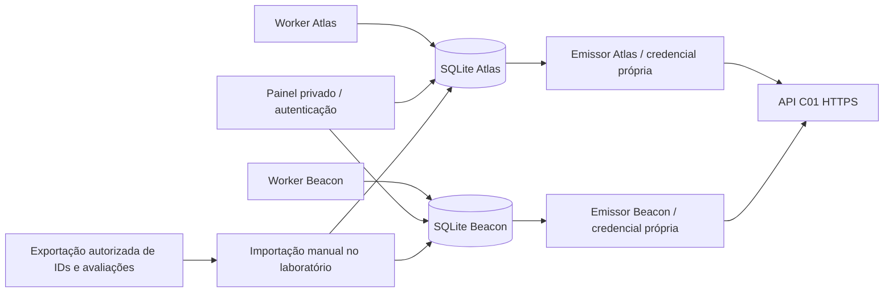

# Laboratório Vivo — Missão 20.7B

Sistema independente do produto, em `living-lab/`, extraível para outro repositório sem alterar imports. Python 3.12/3.13 + SQLite da biblioteca padrão, sem dependências de produção. A imagem Docker copia **somente** `lab/`: não contém o frontend, SQL, `.env`, SDK Supabase ou componentes C01–C10. Base desta entrega: `main` `de8e4ca675e36f7c5fcb7cc014e409f8a968fe83`.

**Nenhuma ligação ou implantação hospedada foi executada.** A configuração de exemplo está `offline`, com envio desligado, endpoint `.invalid` e sem credenciais. Não foram criadas empresas, contas, chaves ou migrações no CENTERWAY. Não há alterações no seu Cron. A implantação e a ligação só devem acontecer depois da revisão/autorização humana.

## Arquitetura e fronteiras



Cada empresa tem base SQLite própria (WAL, `synchronous=FULL`), identidade, fonte, semente, clientes e cursor temporal. Um worker por empresa tenta geração, formação de lote e entrega independentemente: um 401, fila cheia ou estado corrompido numa empresa não interrompe o worker da outra. Threads e bases são separadas; uma falha do host/processo, disco partilhado cheio ou configuração global inválida pode afetar ambas. Para isolamento de infraestrutura, executar serviços/volumes separados com `serve --company atlas` / `--company beacon`; cada painel então mostra a sua empresa. Isso não é isolamento multiutilizador do painel: o seu operador autorizado vê a verdade privada das empresas incluídas nessa instância.

O serviço executa autonomamente, sem sessão de Codex, browser ou telemóvel aberta. O painel é apenas controlo/observação; fechá-lo não para workers. Um processo reiniciado retoma cursores, pedidos, tentativas e leases no volume. Não usa GitHub Actions, refresh do browser, Supabase Cron ou o Cron do CENTERWAY como agendador. Actions serve apenas para testar.

## Empresas, indicadores e regras do simulador

Por defeito: **Atlas Support SaaS**, semente `20701`, 24 clientes `atlas-001`–`atlas-024`; **Beacon Workflow SaaS**, semente `20702`, 24 clientes `beacon-001`–`beacon-024`. São duas identidades distintas, sem dados reais. Podem ter 12–200 clientes cada, configurados antes do primeiro arranque.

| Indicador | Tipo/unidade | Significado operacional sintético |
|---|---|---|
| `cycle_minutes` | numeric / `min` | Duração de processamento observada para o cliente naquele ciclo; menor representa operação mais rápida |
| `delivery_pct` | numeric / `%` | Percentagem de entregas observada naquele ciclo; maior representa melhor operação |

O laboratório não calcula C02, C04, cumprimento de promessas ou causas inferidas. As configurações/objetivos documentados e aprovados no CENTERWAY são definidos por um administrador pelo mecanismo existente, separadamente. Não são inventadas políticas comerciais para fazer a simulação passar. Sem avaliação recolhida, a comparação continua vazia.

O motor `living-v1` usa PRNG derivado por SHA-256 de semente, slot UTC e cliente; identidades UUIDv5 estáveis por empresa/medição. Mesma configuração e mesma sequência de instantes reproduzem factos e valores. O intervalo real padrão é 60s (mínimo 10s). A semente não prevê a avaliação que o CENTERWAY produzirá. O agrupamento em lotes também depende do instante de despacho e backlog: a reprodução dos **pedidos** exige o mesmo calendário de despacho, não só a semente.

Doze coortes, repetidas duas vezes por empresa, estão documentadas em `lab/engine.py`:

| Coorte privada | Regra/acontecimento |
|---|---|
| normal | Duração perto de 85min com pequena variação; entregas 92–99% |
| improvement | Duração desce progressivamente de 100 até 20min |
| gradual_deterioration | Duração sobe de 65 até 240min |
| sudden_deterioration | Mudança de 60 para 160min a meio de cada período de 24 ciclos |
| oscillation | Pico isolado de 135min a cada oito ciclos, base 65min |
| insufficient | Sensor omite cerca de 80% dos ciclos; nenhum valor é preenchido |
| late | Exportação atrasada 2–6 ciclos, preservando `observed_at` original |
| correction | Calibração exige nova linha; o original fica intacto, correção aguarda ID autorizado |
| independent | Duração melhora enquanto percentagem de entregas piora |
| activity | Cliente pausa quatro em cada doze ciclos e regressa com a mesma identidade |
| integration_outage | Janela técnica da integração suspende envio da empresa por três em cada 40 ciclos; geração continua na fila |
| unknown_cause | Duração varia; a causa é `null`, não é inventada nem inferida |

As curvas e fases estão na verdade privada; os valores não contêm cenários, causas nem resultados esperados. A segunda medição pode faltar e o número de linhas varia. Lotes de 1, 7, 31, 127, 500 ou 1000 linhas surgem conforme semente/slot e backlog. A declaração de cobertura `[start,end)` só cobre os instantes do lote; **não afirma completude**. Nenhum campo textual revela causas ou classificação ao CENTERWAY.

## Tempo, pausa e durabilidade

- O daemon usa o relógio real UTC do host. Só gera observações com instante não futuro. Não define o relógio do CENTERWAY.
- Cada slot é registado na mesma transação dos seus factos/medições: reiniciar/repetir o slot não duplica dados. Catch-up após indisponibilidade processa no máximo 30 slots por ciclo de worker e marca esses slots `synthetic_history`; o slot atual é `realtime`.
- Pausar pelo painel persiste o controlo e interrompe geração, formação de lotes e novos claims. Uma chamada HTTP já em curso pode concluir. Retomar salta o intervalo pausado e regista `paused_gap`, em vez de inventar medições desse intervalo. Backlog anterior continua preservado.
- Histórico deliberado: com **empresa nova, antes do primeiro arranque do daemon**, executar `python -m lab --config /CAMINHO/config.json history --company atlas --hours 1`. Todas as linhas são marcadas `synthetic_history`, nenhum envio é executado por esse comando. O limite de segurança é 1–168h, mas o limite de backlog pode impedir históricos grandes: reduzir horas/clientes; não apagar dados nem burlar o limite. Nunca executar este comando em paralelo com o daemon da empresa. O slot sentinela inicial é apenas cursor técnico.
- A demonstração acelerada é explicitamente histórica e usa relógio **do laboratório de teste** injetado; não é prova de tempo real. O teste separado do daemon inicia outro processo, usa relógio de parede real, observa novas medições e reinicia o processo com a mesma base.
- Guarda-se corpo serializado, hash SHA-256 e UUID do pedido **antes** da rede. HTTP fora da transação; claim/lease durável de 180s com token evita disputa entre workers. Leases expiradas marcam resultado desconhecido e recuperam o mesmo corpo/UUID. A garantia é **pelo menos uma entrega**, com idempotência do C01; não se alega transporte exactly-once.
- Geração para ao atingir 100 mil medições sem lote; formação para com 5000 lotes não concluídos. A etapa de entrega continua a drenar apesar dessas falhas. Existe limite de 1000 linhas e budget conservador de 1,8MB por JSON, incluindo espaços; o C01 continua autoridade sobre os limites exatos de JSONB.

## Contrato e recuperação HTTP

A única integração de saída é `POST /functions/v1/ingest-v1/observations`, conforme [contrato C01](../docs/ingestion-api.md). Sem `service_role`, JWT administrativo, SDK ou acesso direto às tabelas CENTERWAY. Nenhuma chamada C02–C10. HTTPS obrigatório em modo `live`, CA e hostname verificados, redirects recusados. O modo `controlled` só aceita HTTP para o literal `127.0.0.1`; não é um modo de produção.

Cada empresa requer ficheiro próprio de credencial `cw_ingest_v1_…`; se ambos os ficheiros legíveis contiverem a mesma chave, o envio bloqueia. Ausência/chave inválida no ficheiro B não impede A. Reservam-se no banco **até 10 pedidos por janela móvel de 60s**, incluindo retries e resultados desconhecidos, abaixo dos 30/minuto UTC do C01. Usar credencial **exclusiva** do laboratório; outro emissor com a mesma chave não está incluído no seu contador. Clock skew, latência e quotas da plataforma ainda podem provocar 429: respeitar o `Retry-After` como mínimo, inclusive HTTP-date, e repetir as mesmas identidades.

200 só é confirmado se o corpo representar lote concluído e os totais forem coerentes. Timeout/ligação perdida/503/5xx transitório/200 ambíguo repetem com backoff determinístico e corpo imutável. 400/401/409/413/422 e redirects ficam `blocked`, identificáveis por status, código e erros de linha sanitizados. Não alterar conteúdo sob o mesmo UUID. Resolver a causa/rotação e repetir manualmente **o mesmo** lote bloqueado com `retry-blocked --company atlas --batch UUID`. Erros de dados/perfil não se corrigem por esse comando: exigem revisão e um novo fluxo/época; esta versão não tem editor arbitrário de payloads nem repartição automática de 413. Nenhum lote desaparece silenciosamente.

A ligação/perfil/fonte/seed/clientes/intervalo/modo ficam ligados por hash ao estado. Mudar esses campos num volume existente aborta a empresa, em vez de reenviar backlog para outro destino. Para nova configuração, pausar, fazer backup/exportação e rever uma nova época em volume novo; manter o anterior para diagnóstico/histórico. Rotação do segredo no mesmo destino/fonte pode ser feita por substituição atómica do ficheiro; ele é relido por envio. Os UUIDs da fila continuam iguais.

## Correções: IDs não disponíveis na resposta C01

C01 devolve lote e contagens, **não os IDs das observações**. Por isso, uma correção fica explicitamente pendente e visível no painel até um operador importar recibos de uma exportação autorizada. Nenhuma consulta de leitura é feita com a credencial de ingestão. O laboratório verifica empresa, perfil, fonte, cliente, indicador, instante, valor e reconhecimento prévio do lote original; um ID já associado não muda. Representações equivalentes de UUID, fuso ISO e decimal são normalizadas, sem tolerância numérica ou alteração do valor.

Formato do ficheiro privado de recibos (usar dados efetivamente exportados, não este exemplo):

```json
{"company":"atlas","receipts":[{
  "measurement_key":"UUID_ESTAVEL_ENVIADO",
  "observation_id":"UUID_REAL_DA_OBSERVACAO",
  "profile_id":"UUID_PERFIL_APROVADO",
  "source":"living-lab-atlas",
  "subject_external_ref":"atlas-008","indicator_key":"cycle_minutes",
  "observed_at":"2026-10-21T12:00:00Z","value_numeric":"85.000"
}]}
```

```sh
python -m lab --config /CAMINHO/config.json import-receipts --company atlas --file /PRIVADO/receipts.json
```

Só então a nova linha recebe `corrects_observation_id`. Não se inventam UUIDs, não se ramifica uma correção, não se reescreve original, e C01 ainda valida a relação. Na demonstração, os IDs vêm exclusivamente do estado privado do **receptor controlado**, não de uma resposta C01 ficticiamente enriquecida.

## Painel e comparação

`/` é privado, com HTTP Basic, senha mínima de 20 caracteres em ficheiro secreto, sem CORS, sem segredos em respostas/logs, cache `no-store`, proteção de framing e token CSRF para controlos. No hospedado, exigir TLS no proxy/serviço e restringir acesso (VPN/allowlist/proxy de identidade quando disponível); o HTTP interno só deve ficar na rede privada. Não expor diretamente o servidor Python à Internet sem proxy com limites de conexões/pedidos e timeouts. `/healthz` só diz que o processo responde; **não certifica** progresso das duas empresas. Ver também `last_cycle`, `last_error`, fila, tentativas e última medição no painel autenticado.

O painel apresenta clientes ativos e coortes, totais de produção/aceitação, correções sem IDs, proveniência temporal, estado de fila, HTTP/códigos/retries, erros técnicos persistentes, verdade privada paginada e avaliações importadas. Paginação do histórico: 100 eventos por página; tentativas recentes: 50; comparações recentes: 100. O export privado permite consultar todo o histórico, que não é truncado por esses limites de apresentação.

Importar avaliações somente de meios autorizados (exportação pelo utilizador com os seus direitos existentes), guardando a referência verificável. O laboratório não autentica essa proveniência por si: importação manual não é certificação externa. O mesmo `external_id` aceita replay igual e recusa alteração; uma avaliação revista usa ID novo.

```json
{"company":"atlas","evaluations":[{
  "external_id":"ID_REAL_DA_AVALIACAO", "client":"atlas-001", "indicator":"cycle_minutes",
  "observed_until":1792584000, "actual_result":"inconclusive", "evidence_ref":"referencia-a-exportacao-autorizada"
}]}
```

```sh
python -m lab --config /CAMINHO/config.json import-comparisons --company atlas --file /PRIVADO/evaluations.json
```

A comparação reúne a avaliação recebida e os últimos factos/medições privados do mesmo cliente/indicador até ao corte informado. É uma vista para revisão humana, **não outro classificador, cálculo de cumprimento ou nota automática de acerto**. O estado íntegro pode ser exportado para análise completa de janelas. Valores desconhecidos e inconclusões continuam legítimos.

## Reprodução isolada e evidência

```sh
cd living-lab
PYTHONDONTWRITEBYTECODE=1 python3 -m unittest discover -s tests -v
PYTHONPATH=. python3 tests/demo.py
# Apenas ferramentas de teste; não fazem parte da imagem de produção:
python3 -m pip install playwright==1.62.0
python3 -m playwright install chromium
PYTHONPATH=. python3 tests/browser.py
# Ou LAB_BROWSER_BIN=/usr/bin/chromium quando já instalado.
```

Demonstração de semente fixa: **48 clientes, 100 ciclos históricos**, **4052 medições únicas aceites pelo receptor controlado** (Atlas 2046; Beacon 2006), **36 correções**, **33 tentativas HTTP** (18 + 15), incluindo três tentativas falhadas/ambíguas de Atlas (resposta perdida após commit, 503, 429); Beacon continua independente; **zero lotes pendentes**. Não são contagens de ingestão CENTERWAY. Só a seed e a timeline do teste tornam esses números determinísticos.

21 testes de unidade/integração cobrem engine, reinício, catch-up, dados ausentes, causas desconhecidas, allowlist/bytes/cobertura, replay após perda de resposta, 429, erros permanentes/redirect, sucesso ambíguo, leases, concorrência/quota persistente, isolamento, recibos/correções, importações imutáveis, autenticação/CSRF/pausa e processo autónomo com relógio real. TLS rejeita certificado não confiável e aceita receptor HTTPS controlado com CA de teste explicitamente confiada, sem desativar verificação. O browser verifica desktop/mobile, autenticação, pausa independente com reload, paginação, preservação de secções abertas, texto importado inerte e ausência de erros JS.

Actions: workflow **Independent living SaaS laboratory**, duas versões Python e job browser. Só usa receptores loopback e segredos sintéticos; não precisa de secrets GitHub nem faz deploy. Artifacts contêm apenas agregados e screenshots de fixtures sintéticas. A validação com receptor controlado não prova autenticação/RLS, quotas internas ou disponibilidade do CENTERWAY hospedado.
