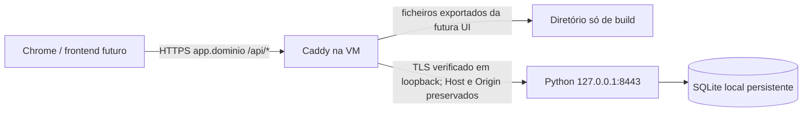

# Missão 04 — infraestrutura proposta, não publicada

Decisão de preparação: **uma VM Linux pequena, Caddy e um processo Python com SQLite
em disco local persistente**. Não criar Kubernetes, Redis, workers, Postgres,
Terraform ou serviços adicionais nesta fase. Nenhum alojamento foi contratado,
nenhum serviço foi instalado/ativado e nenhuma base existente foi migrada.

## Auditoria do backend do PR #33

| Requisito observado | Consequência de infraestrutura |
| --- | --- |
| Python 3.11+, biblioteca padrão; testado em 3.12 | Não exige runtime Node para a API; Node só para construir futuramente a UI e executar QA |
| HTTP server próprio e threads; privado limitado a 32 | Precisa de processo persistente; não é WSGI/ASGI nem função serverless |
| SQLite schema 2, ficheiro + rollback journal; BEGIN IMMEDIATE, timeout 10 s | Disco local gravável e persistente; diretório também gravável; uma instância, sem autoscaling/replicação/NFS |
| Sessões opacas e memberships em SQLite | Sessões sobrevivem a restart; não adicionar Redis nem guardar tokens em JS |
| Credenciais scrypt privadas, Cookie __Host-/Secure/HttpOnly/Strict | HTTPS real no backend; não confiar em X-Forwarded-Proto como substituto de TLS |
| Host e Origin presos à origem privada | Decidir domínio antes de preparar o sandbox e preservar Host completo e Origin no proxy |
| Sessões 1 h; licença temporal da pré-visualização até 24 h | Restart não renova prazo/contas; a demo não é um serviço de produção permanente |
| Sem conectores, IA real, cron ou e-mails | Nenhuma chave de IA/SMTP, fila ou acesso externo é necessário para os ciclos |
| Store() cria schema/seed/migra; era usado ao arrancar o preview | Corrigido: o arranque privado passa a abrir apenas uma base já preparada, sem DDL/seed/migração |
| Dados iniciais datados; regras usam date.today() | Serviço define TZ=UTC; restart não inventa observações para preencher dias novos |

Dimensionamento **sugerido**, não benchmark: 1 vCPU, 1 GB RAM como ponto de partida
para ensaio curto, 2 GB preferível para margem de OS, Caddy e scrypt concorrente.
Reservar alguns GB livres para journal, snapshots e logs. Os testes cobrem 150
clientes, não constituem teste de carga ou garantia de capacidade/SLA.

## Comparação de alojamentos — consulta em 25/10/2026

Valores indicativos, não uma cotação/contratação. Sem impostos, câmbio, domínio,
backup fora do host ou excesso de tráfego. Confirmar disponibilidade e preço antes
de qualquer decisão futura. Foram consultadas fontes oficiais, não só comparadores.

| Opção | Custo publicado / condições | Python, HTTPS e persistência | Avaliação para este código |
| --- | --- | --- | --- |
| Render Free | US$0 | Python e TLS gerido; sem disco persistente no serviço gratuito | Inadequado para a SQLite atual; não usar disco efémero nem substituir por Postgres nesta missão. [Limites oficiais](https://render.com/docs/free) |
| Render pago + disco | Referência Starter US$7/mês + US$0,25/GB-mês; exemplo 1 GB ≈ US$7,25/mês | Python, TLS público gerido e disco pago | Alternativa gerida, mas ingress/TLS e supervisão dos processos requerem desenho específico; o backend atual não deve simplesmente aceitar headers de proxy. [Preços](https://render.com/pricing), [discos](https://render.com/docs/disks), [TLS](https://render.com/docs/tls) |
| Railway Free / Hobby | Free: US$0, orçamento de utilização limitado (página indica US$1/mês após trial), 0,5 GB de volume. Hobby: mínimo US$5/mês, inclui US$5 de uso; excedentes cobrados | Python, domínios HTTPS e volumes; limites variam por plano | Gratuito não equivale a funcionamento contínuo garantido. Hobby é económico, mas consumo não tem teto de US$5. Precisaria de adaptação validada ao ingress/volume da plataforma; não há manifesto Railway pronto. [Preços oficiais](https://railway.com/pricing), [planos/volumes](https://docs.railway.com/pricing/plans) |
| VM Hetzner | Tabela EU: CX23 €5,49/mês e CAX11 €5,99/mês, sem IPv4/IVA; a linha Cost-Optimized está sinalizada como indisponível na página consultada | Linux com disco local; Caddy fornece HTTPS após DNS e portas | Compatível com a arquitetura proposta. Esses preços não garantem stock; pedir cotação/plano disponível. Não prometer VM de €5,49 comprável. [Tabela oficial](https://docs.hetzner.com/general/infrastructure-and-availability/price-adjustment/), [disponibilidade](https://www.hetzner.com/cloud/) |
| Oracle Always Free VM | US$0 dentro dos recursos elegíveis; disponibilidade na região e possibilidade de recuperação de instâncias inativas | VM Linux e armazenamento, HTTPS gerido pelo operador | Pode executar a mesma solução sem mensalidade de compute, se já existir capacidade/conta. Não é base para prometer acesso estável gratuito. [Recursos e limites oficiais](https://docs.oracle.com/en-us/iaas/Content/FreeTier/freetier_topic-Always_Free_Resources.htm) |

Orçamento de planeamento para uma VM disponível: **€6–20/mês antes de impostos e
extras**, a confirmar com o fornecedor. É uma estimativa nossa, não um preço
oferecido; não depende de conseguir um plano esgotado. Caddy não cobra licença e
HTTPS automático não requer comprar um certificado. Domínio e cópia externa têm
custo/condições a definir. Manutenção de Linux, backups e certificados locais fica
com o operador. Um PaaS pode reduzir esse trabalho, mas não é turnkey para este
servidor TLS existente. Nenhuma escolha de fornecedor foi efetuada.

## Mesma origem para o futuro frontend



O frontend futuro pode ser desenvolvido no Lovable, mas a solução preferida serve
**o build exportado** e `/api/*` na mesma origem controlada pelo projeto. Esta missão
não usa Lovable nem produz ou reconstrói UI. A exportação/build real é uma dependência
futura. O diretório `/srv/centerway/frontend/current` não contém dados, código do
backend, checkout Git, `.env`, backups, certificados ou credenciais.

Se a UI tiver de continuar alojada num domínio controlado pelo Lovable, não temos
como instalar o nosso `/api/*` nesse domínio. Não basta DNS, redirect ou mudar a URL
base para obter mesma origem. A alternativa já preparada na Missão 03 é domínio
próprio com subdomínios HTTPS same-site e CORS exato; depende da capacidade/plano de
domínio do frontend, não verificada nem contratada. Outra autenticação cross-site
seria uma tarefa separada. Não mudar cookies para None nem distribuir tokens em JS.

`infra/Caddyfile` preserva `/api` (não usa handle_path), o Host completo incluindo
porta e a Origin enviada pelo browser. Mantém cookies e códigos de erro da API.
Não faz retry de balanceador para POST; ligações upstream sem keepalive evitam
reutilizar conexões fechadas pelo servidor da biblioteca padrão. Não reescreve 404
ou 502 da API para index.html, nem inventa uma resposta de sucesso.

Caddy termina HTTPS público e verifica outro TLS no Python em loopback, confiando
num certificado local específico com SAN localhost. Não usar tls_insecure_skip_verify.
O backend não escuta externamente; firewall futuro só permite 80/443 e SSH restrito.
O certificado público fica a cargo do HTTPS automático do Caddy após DNS/ACME; o
certificado local não é apresentado ao Chrome. O teste usa certificados temporários
confiados explicitamente; **não prova certificado público nem acesso externo**.

Não são necessários CORS ou headers Authorization na topologia preferida. As
permissões, tenants e clientes continuam a ser verificados pelo Core. Atrás do proxy,
o limitador atual vê o IP de loopback: o limite por IP agrega todos os utilizadores;
o limite por conta continua a existir. Não se passou a confiar em X-Forwarded-For.

## Dados, autenticação e segredos

- Base: `/var/lib/centerway/preview.sqlite3`, modo 0600, diretório 0700, utilizador
  dedicado `centerway`. Esse diretório tem de estar no disco/volume persistente.
- Preparação de uma **base fictícia nova** continua a ser uma operação manual de
  `centerway.preview init` autorizada separadamente. Não é ExecStart, deploy hook,
  restore automático, renovação de prazo ou migração de uma base existente.
- Passwords aleatórias são fornecidas em privado e guardadas só como hash no SQLite.
  O ficheiro inicial de entrega fica fora do checkout e do build, modo 0600, e não
  precisa de ser legível pelo serviço depois da entrega. Não colocar segredos em
  runtime.env, VITE_*, GitHub, HTML, logs ou argumentos de comando.
- Chave TLS local: `/etc/centerway/backend-key.pem`, root:grupo centerway, modo 0640;
  certificado local: backend-cert.pem. Só a cópia pública de confiança
  backend-ca.pem precisa de ser legível pelo Caddy. A rotação atualiza o par e essa
  confiança, seguida de restart controlado; não desativa verificação TLS.
- Segredos de ACME/chaves privadas do site ficam no armazenamento persistente e
  restrito do Caddy. O serviço da API não deve poder escrever o código, build ou CA.
- Sessões persistem no SQLite durante a sua validade de 1 h. Logout revoga; restart
  não recria contas nem renova sessões ou a pré-visualização de 24 h. No perfil demo não há
  auto-renovação de lease ou recuperação de conta; identidade permanente separada
  está documentada na atualização Missão 05 abaixo.

## Reinícios, verificações e snapshots

`centerway-backend.service` é um **modelo não instalado**, para systemd numa VM:
utilizador sem privilégios, sistema de ficheiros protegido, UTC, permissões restritas,
check antes do arranque e restart em falha com limite de tentativas. SIGTERM termina
aceitação e drena os pedidos existentes; TimeoutStopSec é 45 s. Um crash deixa o SQLite
recuperar transações incompletas; o teste verifica que a escrita não confirmada não
aparece após reabrir. Não se promete zero downtime ou sobrevivência à perda do disco.

Caddy deve correr pelo serviço oficial da distribuição, com ambiente não secreto
`CENTERWAY_PUBLIC_HOST=app.dominio` e acesso de leitura ao build e backend-ca.pem.
Os modelos `caddy.env.example` e `caddy.service.d/centerway.conf` mostram como
fornecer esses valores ao serviço da distribuição; não foram instalados.
O backend usa o seu EnvironmentFile `/etc/centerway/runtime.env` com CENTERWAY_ORIGIN
igual à origem já gravada na base. O ficheiro de exemplo não é uma configuração ativa.
Com admin off, mudanças de Caddy requerem restart controlado, não caddy reload.
Não foi emitido certificado nem alterado DNS/firewall/systemd neste ambiente.

Os seguintes comandos são para um operador futuro, não são deploy automático:

```sh
cd /opt/centerway/v2
python3 -m centerway.ops check --db /var/lib/centerway/preview.sqlite3 --origin https://app.example.invalid
python3 -m centerway.ops backup --db /var/lib/centerway/preview.sqlite3 --out /caminho-privado/snapshots/ensaio-01.sqlite3
python3 -m centerway.ops verify-backup --db /caminho-privado/snapshots/ensaio-01.sqlite3
```

`check` recusa base ausente, versão/índices/triggers inadequados, falha de integridade,
permissões abertas, origem errada ou lease expirado. Não cria ou repara schema. A
ligação em modo rw também impede criar outro SQLite vazio se o volume desaparecer.
Não existe novo endpoint público de health; o check é local e não devolve clientes,
passwords ou sessões. Os erros CLI não imprimem caminhos/valores sensíveis.

`backup` usa SQLite backup API, não cp do ficheiro ativo; verifica integridade e FKs,
não sobrescreve destinos e exige diretório privado. Também permite preservar uma
base com lease expirado, sem o renovar. `verify-backup` valida schema, proteções e
integridade e calcula SHA256. **Não existe comando de restore/migração nesta entrega**.

Para este ensaio curto, tirar snapshot antes de qualquer atualização e depois de
marcos importantes. Uma política futura diária teria RPO máximo aproximado de 24 h,
não perda zero; não há scheduler/offsite configurado. Copiar para outro diretório do
mesmo disco não protege contra perda da VM. Antes de transferir uma cópia para fora,
criptografá-la e guardar a chave separadamente: o snapshot contém hashes e sessões.
Retenção e destino externo dependem do operador/infraestrutura ainda não escolhidos.

Recuperação futura: parar serviço, preservar a base avariada, validar uma cópia numa
localização privada e comparar histórico/versão, só então aprovar a substituição.
Rever/revogar sessões restauradas, pois a cópia pode conter tokens válidos. Não fazer
rollback cego do SQLite após executar ações; perder registos posteriores ao snapshot
pode tornar essa recuperação incompleta. O teste apenas abre cópias descartáveis de
dados sintéticos; não migra ou substitui dados de ninguém.

## O que está pronto e o que falta

| Preparado e verificável agora | Depende de infraestrutura/autorização futura |
| --- | --- |
| Auditoria, comparação e topologia de mesma origem | Escolher fornecedor, aceitar custos e disponibilizar VM/conta |
| Modelo Caddy com TLS verificado e rotas separadas | Domínio controlado, DNS, portas/ACME, certificado público |
| Modelo systemd e SIGTERM controlado | Instalação/ativação de serviços, SO atualizado e firewall |
| Abertura sem seed/DDL/migração; check e snapshot | Disco persistente real, ownership e credenciais próprias |
| Testes com o binário Caddy e bases temporárias | Build exportado da futura UI e implementação desse cliente |
| Regressões API/C01–C06 e segurança | Backup externo, rotação e validação Android/certificado público |

Sem frontend exportado, a rota estática fica ausente/404; não encaminha para a UI do
laboratório. Sem backend ou com certificado upstream não confiável, a API falha
(502), não cai em HTTP nem em HTML da SPA. Erros de infraestrutura podem não ser
JSON do contrato; o futuro cliente deve tratá-los como falha de transporte, nunca
como recuperação ou execução bem-sucedida.

## Reproduzir QA sem contratar/publicar

```sh
cd v2
python3 -m pip install -r tests/requirements.txt
bash infra/fetch-test-caddy.sh /tmp/centerway-qa-caddy
CADDY_BIN=/tmp/centerway-qa-caddy/caddy python3 -m unittest discover -s tests -v
systemd-analyze verify --man=no infra/centerway-backend.service
```

O helper é só para QA Linux x86_64: baixa Caddy 2.11.7 do release oficial, verifica
SHA512 fixado e instala apenas no diretório indicado; não instala um serviço.
O [release oficial](https://github.com/caddyserver/caddy/releases/tag/v2.11.7) foi
consultado em 25/10/2026. O Caddyfile segue a [documentação oficial de proxy/TLS](https://caddyserver.com/docs/caddyfile/directives/reverse_proxy).
Sem CADDY_BIN/caddy, o teste de proxy é marcado como skipped; a CI fornece o binário
verificado e executa-o. O teste usa só portas de loopback, certificados temporários,
uma fixture de routing sem UI de produto e dados fictícios.

Não foi testada a unidade systemd em execução num host real, renovação ACME pública,
mount de volume de fornecedor, tráfego de produção, restore operacional ou Lovable.
C01–C06, Core, schema e interface do produto permanecem iguais aos do PR #33.

## Atualização Missão 05

A auditoria e comparação acima descrevem a base do PR #34. A demo mantém o lease
de 24 h. A [fundação permanente](../PERMANENT_FOUNDATION.md) acrescenta identidade
privada sem esse lease, com base/contas/serviço separados e todas as operações de
negócio bloqueadas. Não é ainda operação real permanente de C01–C06. Templates em
`production/` reutilizam o mesmo Caddyfile; nenhum foi instalado ou publicado.
